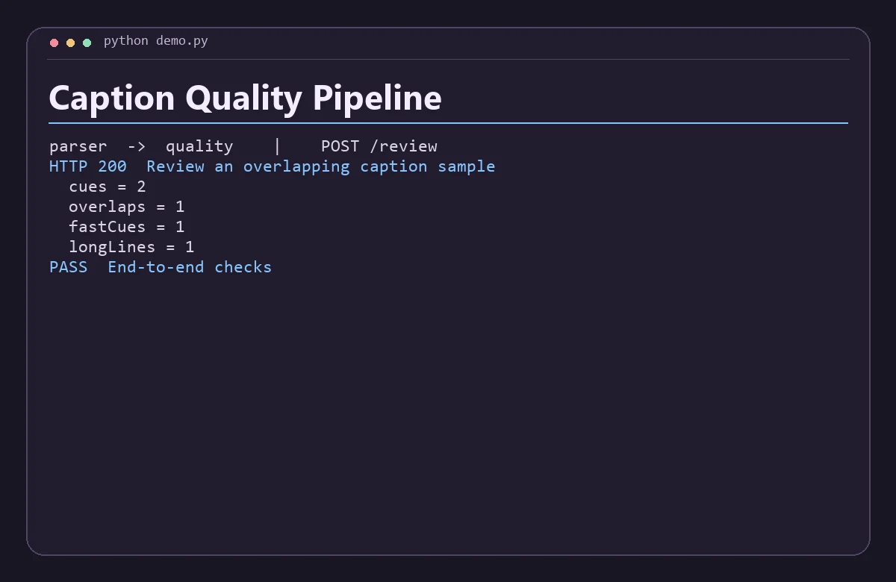

# Caption Quality Pipeline

Parse SubRip captions in one service and measure timing overlaps, reading speed and long lines in another.



## Run the demo

Install Python 3.11+, Node.js 22+, then run this from the repository root.

```sh
python demo.py
```

The command starts both services on separate loopback ports, sends the requests in `examples.json`, checks the responses, and shuts down the processes. Use `python3` if that is how your system exposes Python.

## Run the services with Docker Compose

```sh
docker compose up -d --build
python demo.py --base-url http://127.0.0.1:8080
docker compose down
```

The API binds to loopback on port 8080 by default. Set `DEMO_PORT` and use the matching base URL to run another project alongside it. Set-up and service discovery follow the [Docker Compose networking documentation](https://docs.docker.com/compose/how-tos/networking/).

Both services are stateless and work with the data in each request. Start from fresh demo state before rerunning the scripted Compose checks.

## Architecture

Parser converts SRT timestamps to millisecond offsets. Quality checks durations, temporal overlap, characters per second and line length across the resulting cues.

| Service | Runtime | Operation |
| --- | --- | --- |
| `parser` | JavaScript | Public demo API, `POST /review` |
| `quality` | Python | Internal service, `POST /score` |

The two services exchange JSON over HTTP. Each has a `GET /health` endpoint for process readiness. Compose starts the API after the internal service passes its readiness probe. A gateway request returns HTTP 502 when its dependency is unavailable or fails unexpectedly. Invalid input returns HTTP 400. Domain conflicts return HTTP 409 where supported.

## API example

Send an srt string with standard SubRip blocks. Quality flags reading rates above 20 characters per second and lines longer than 42 characters. The checks are diagnostics and do not establish accessibility compliance.

From a running Compose stack, save this JSON as `input.json` and run the command below. On Windows use `curl.exe` if your shell aliases `curl`.

```json
{
  "srt": "1\n00:00:00,000 --> 00:00:02,000\nThe tide is rising.\n\n2\n00:00:01,500 --> 00:00:02,000\nThat is too much text to read in half a second."
}
```

```sh
curl -s -H "Content-Type: application/json" --data-binary @input.json http://127.0.0.1:8080/review
```

The response includes these fields.

```json
{
  "cues": 2,
  "overlaps": 1,
  "fastCues": 1,
  "longLines": 1
}
```

## Scope

This is a local portfolio project using synthetic data. The APIs are intended for loopback and the private Compose network. A public deployment would need authentication, rate limits, and production observability.
